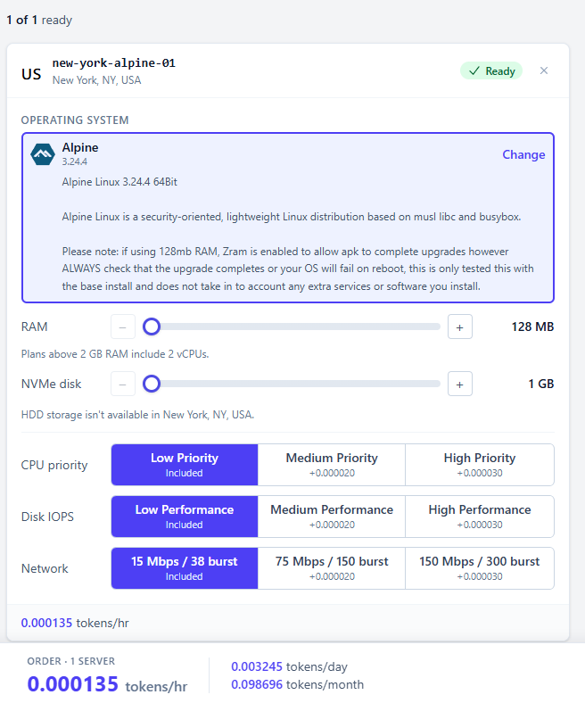
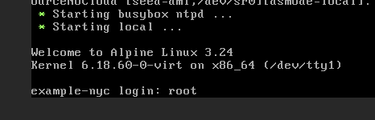

# Server Setup

## Section 1: Find a Host

1. Find somewhere you can rent a server for next to nothing. [TierHive](https://tierhive.com/) is great for this.
   - You can get a 128 MB RAM, 1 GB disk, server for under 10 cents a month.

   While this guide uses this host and Alpine Linux, feel free to use a different provider.

2. Create an account.
3. Add funds to pay for your VPN endpoint(s).

## Section 2: Provision a Server

1. Go to [TierHive VPS creation](https://control.tierhive.com/vps/precreate).
2. Pick a server location (where your traffic will appear to come from).

   > **Note:** Some servers have faster bandwidth speeds, and picking international options may cause websites to serve you in different languages.

3. Pick an OS - in this case **Alpine 3.24.4** or similar.
4. Pick settings. The lowest option is fine:
   - 128 MB RAM
   - 1 GB NVMe disk (boot)
   - 0 HDD (extra storage)
   - Low CPU priority
   - Low Disk IOPS
   - **Network:** Use your own judgement here. You may want to upgrade your line speed if you plan to stream and/or selected a location with a slow base speed.

   <p align="center">
     
   </p>

   You can change all of these settings later.

5. Hit **Continue** and give your server a **Friendly Name** and hostname. These don't really matter for us and can be changed later, so put whatever you want.

   Pick any private IP, leave the DNS options as Cloudflare, and hit **Continue**.

6. Review and check that your tokens are something like **0.098/month** (1 token = 1 dollar), then hit **Deploy Server**.
7. You should now be greeted with a console showing the VPS (server) installing, and a root password. Copy this somewhere. You'll need it.

## Section 3: Connect to the Server

You can use [Kitty](https://sw.kovidgoyal.net/kitty/), [PuTTY Portable](https://www.chiark.greenend.org.uk/~sgtatham/putty/latest.html), or similar to connect using the **SSH Access** details on the control panel and the root password you copied.

For simplicity, I will use the web console in this article.

1. From the VPS management page (something like `https://control.tierhive.com/vps/manage/123456`), look in the top right for an **Open Console** button. Click it.

   <p align="center">
     
   </p>

2. Once the console loads you should see a login prompt. Enter username `root` and your random password.

   <p align="center">
     
   </p>

   > **Note:** You will need to click the console to type, and will need to use the **Clipboard** button at the bottom to paste text.

3. Change your password by typing `passwd` and entering a new random password. Don't lose it.

## Section 4: Install Updates and Configure Autoupdate

> **Warning:** Pasting from the browser into the web console may not insert the full text for some of the longer scripts in this guide. Prefer the link-based install below, or use [Kitty](https://sw.kovidgoyal.net/kitty/) or [PuTTY Portable](https://www.chiark.greenend.org.uk/~sgtatham/putty/latest.html) with SSH.

This runs a one-time `apk upgrade` (with temporary swap for low RAM), installs the daily autoupdate script, and starts `crond`. Script source: [`server-updates.sh`](server-updates.sh).

```sh
curl -fsSL https://raw.githubusercontent.com/CyberdyneVulpine/dollar-per-year-vpn/main/server-updates.sh | sh
```

If `curl` is not available yet:

```sh
wget -qO- https://raw.githubusercontent.com/CyberdyneVulpine/dollar-per-year-vpn/main/server-updates.sh | sh
```

> **Note:** The swap file is only used during upgrades so a 128 MB VPS has enough memory for `apk`.

**Manual only** (upgrade once, no autoupdate):

```sh
fallocate -l 128M /swapfiletemp && chmod 600 /swapfiletemp && mkswap /swapfiletemp && swapon /swapfiletemp && apk update && apk upgrade && swapoff /swapfiletemp && rm /swapfiletemp
```

## Section 5: Next Steps

Continue with [WireGuard Setup](wireguard-setup.md).
