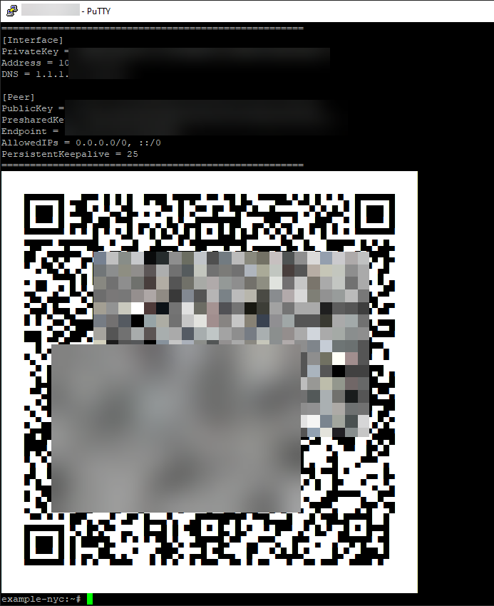

# WireGuard Setup

> **Warning:** Pasting from the browser into the web console may not insert the full text for some of the longer scripts in this guide. Prefer the link-based install below, or use [Kitty](https://sw.kovidgoyal.net/kitty/) or [PuTTY Portable](https://www.chiark.greenend.org.uk/~sgtatham/putty/latest.html) with SSH.

## Setup and helper script

This script installs and configures WireGuard and sets up some useful commands (`wg-add`, `wg-remove`, `wg-list`).

> **Warning:** Rerunning the setup script wipes the existing WireGuard server config and removes every client you have added. Only run it again if you intend to start fresh, then use `wg-add` to recreate devices.

The install script lives in [`wireguard-setup.sh`](wireguard-setup.sh). On the server, run it from GitHub (recommended - avoids pasting the whole file into the web console):

```sh
curl -fsSL https://raw.githubusercontent.com/CyberdyneVulpine/dollar-per-year-vpn/main/wireguard-setup.sh | sh
```

If `curl` is not available yet:

```sh
wget -qO- https://raw.githubusercontent.com/CyberdyneVulpine/dollar-per-year-vpn/main/wireguard-setup.sh | sh
```

Or download first, then run:

```sh
wget https://raw.githubusercontent.com/CyberdyneVulpine/dollar-per-year-vpn/main/wireguard-setup.sh
sh wireguard-setup.sh
```

When prompted, enter the port number shown next to **UDP** under **Forwarded Ports** in the control panel. It will probably be a random 4 digit number like `6543`.

## Create Credentials & Connect

To add a device to the WireGuard VPN:

1. Run `wg-add devicename` (`devicename` can be anything).

   You will see something like the following:

   ```text
   =====================================================
   [Interface]
   PrivateKey = [random letters and numbers]=
   Address = 10.2.3.4/32
   DNS = 1.1.1.1, 8.8.8.8

   [Peer]
   PublicKey = [random letters and numbers]=
   PresharedKey = [random letters and numbers]=
   Endpoint = 123.456.789.111:2345
   AllowedIPs = 0.0.0.0/0, ::/0
   PersistentKeepalive = 25
   =====================================================
   ```

   The same config is saved on the server at `/root/devicename.conf`, and a QR code is printed in the console.

_Phones_

2. On your phone, open the WireGuard app ([iOS](https://apps.apple.com/app/wireguard/id1441195209), [Android](https://play.google.com/store/apps/details?id=com.wireguard.android)), tap **Add tunnel**, then **Create from QR code**, and scan the QR code shown in the console.

   <p align="center">
     
   </p>

   Example output (keys redacted). Yours will show real values and a scannable QR code.

_PCs / Laptops / etc._

3. Install the WireGuard app if you need it ([Windows](https://www.wireguard.com/install/), [macOS App Store](https://apps.apple.com/app/wireguard/id1451685025)).
4. Copy only the `[Interface]` and `[Peer]` sections from the console output into a new text file. Do not include the `=====` lines or any of the status messages above or below them. Save the file as `devicename.conf` (use the same name you passed to `wg-add`, for example `mylaptop.conf`).

   Or copy the file from the server (for example with SCP/SFTP): `/root/devicename.conf`.

5. In the WireGuard app, choose **Import tunnel(s) from file** (on Windows, **Add Tunnel** → **Import tunnel(s) from file...**), select your `.conf` file, then turn the tunnel **On**.

6. Congrats - you should be able to connect and see your IP address change using [whatismyip.com](https://www.whatismyip.com/).

## List Devices

To see every client you have created, run:

```sh
wg-list
```

This prints a table of **IP Address**, **Client Name** (the name you passed to `wg-add`), and a shortened **Public Key** for each device. Use the client name when you need to remove a device.

## Removing a Device

To revoke a device and stop it from connecting, run:

```sh
wg-remove devicename
```

Replace `devicename` with the same name you used with `wg-add` (for example `wg-remove mylaptop`).

This removes that client from the server config, restarts WireGuard so the change takes effect immediately, and deletes `/root/devicename.conf` on the server. The tunnel will still exist on the phone or PC until you delete it there, but it will no longer connect.
